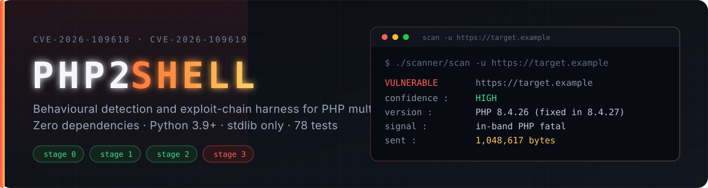

<div align="center">



# PHP2SHELL

**One vulnerability, two tools: a behavioural scanner that proves exposure, and an exploit-chain harness that documents exactly how far the chain gets.**

[](https://github.com/Mr-Destroyer/PHP2SHELL/actions/workflows/ci.yml)
[](https://www.python.org/downloads/)
[](#quickstart)
[](scanner/tests)
[](LICENSE)

</div>

---

## What this is

`php2shell` is an unauthenticated RCE class in PHP core reachable during multipart
request parsing, tracked as **CVE-2026-109618** (Apache `mod_php`) and
**CVE-2026-109619** (php-fpm). This repository holds the two halves of my work on it:

| Tool | What it answers | Entry point |
|---|---|---|
| **[`scanner/`](scanner/)** | *Is this host exposed?* — answers by triggering the OOM path, not by trusting a version string | `./scanner/scan -u https://host` |
| **[`exploit-kit/`](exploit-kit/)** | *How far does the chain actually get?* — stage-by-stage harness with lab evidence | `./exploit-kit/exploit -u https://host` |

Both are pure standard-library Python. Nothing to `pip install`, nothing to compile.

> **The exploit kit does not achieve RCE, and this repo does not claim it does.**
> Stages 0–2 are verified against a live lab; stage 3 delivers the forged
> structures but the carrier never reaches `PS(http_session_vars)`. The evidence,
> including the offsets and the sweeps that failed, is in
> [`exploit-kit/FINDINGS.md`](exploit-kit/FINDINGS.md).

---

## Quickstart

```bash
